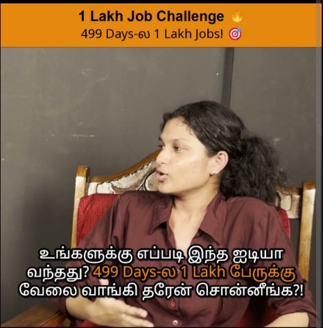

# 🎬 Viral Reel Editor (Automated 9:16 Video Engine)

An automated video editing pipeline engineered to turn raw podcast / interview footage into viral **9:16 Instagram Reels / YouTube Shorts** adhering strictly to signature broadcast standards.

---

## ✨ Features & Design Rules

1. **Persistent Two-Line Header Banner (`#EA8207`)**:
   - 1080x150 px banner locked at `y = 408`.
   - **Line 1**: Main Topic Title + Twemoji (`🔥`, `💡`, `💔`, `🎯`).
   - **Line 2**: Hook Question / Mission Subtitle.
   - Guaranteed **100% persistent loop** across every second and cut of the video.
2. **Zero-Yellow Subtitles**:
   - Spoken dialogue in crisp pure white (`#FFFFFF`).
   - Keyword highlights in signature orange (`#EA8207`).
   - Solid 5px black stroke (`#000000`).
   - Rendered using bundled Unicode Tamil & English fonts (`Noto Sans Tamil Bold`, `Mukta Malar Bold`).
3. **Smart Camera Framing & Cuts**:
   - Auto-crops 1080x940 active window for 2-speaker podcast setups (Guest on Left, Host on Right).
   - Dynamic 1.15x punch-in zoom for impactful statements.
   - 0.6s black-and-white flash to color on opening hook.
4. **100% Outside B-Roll Integration**:
   - Bundled library of cinematic stock B-rolls (graduates, job contracts, error glitch warnings, struggle & resolve, skyscraper sunrise victory).
5. **Mastered Audio**:
   - Blended with royalty-free lo-fi background music ducked at `-20 dB` under speech.
   - Broadcast-standard EBU R128 loudness normalization to `-14.0 LUFS` (`TP = -1.5 dB`).
6. **Clean Letterboxing**:
   - Clean solid black top and bottom letterbox.
   - No floating pill badges, no distracting progress bars.

---

## 🌟 Reference Style Presets

### REFERENCE 11 (Signature Master Template)


**Reference 11** is the master default style for interview and podcast reels:
- **Two-Line Persistent `#EA8207` Header Banner** with Twemojis (1080x150, locked at $y = 408$).
- **Zero-Yellow Subtitles**: Pure white dialogue (`#FFFFFF`), signature orange keyword highlights (`#EA8207`), and 5px solid black stroke (`#000000`).
- **Letterbox Layout**: 1080x1920 canvas with 1080x940 video window at $y = 558$.
- **Clean Solid Black Bars**: No progress bar, no floating chest badges.
- **Ducked Lo-Fi BGM**: Ducked at `-20 dB` under speech + EBU R128 loudness normalization to `-14.0 LUFS`.
- **100% External Stock B-Rolls**: Cinematic cuts matched to spoken topics.

Whenever requested:
> *"Edit this raw video in style of Reference 11"*

Simply run:
```bash
python edit_reel.py --input "RAW_VIDEOS/your_video.mov" --style "reference 11"
```

---

## 🚀 Setup on ANY New Laptop (Windows / macOS / Linux)

### 1. Prerequisites
- **Python 3.10+**
- **FFmpeg**:
  - **Windows**: `winget install Gyan.FFmpeg` or download from [gyan.dev](https://www.gyan.dev/ffmpeg/builds/) (ensure `ffmpeg` is in your PATH).
  - **macOS**: `brew install ffmpeg`
  - **Linux**: `sudo apt install ffmpeg`

### 2. Clone the Repository
```bash
git clone https://github.com/akash30104/reel-editor.git
cd reel-editor
```

### 3. Install Python Dependencies
```bash
pip install -r requirements.txt
```

---

## ⚡ How to Edit Reels

You **do not need to recreate any reference styles**! Just drop your raw video and run:

### Simple One-Click Run:
Drop your `.mov` or `.mp4` into `RAW_VIDEOS/`, then run:
```bash
python edit_reel.py
```

### Custom Title & Subtitle:
```bash
python edit_reel.py --input "RAW_VIDEOS/my_video.mov" \
                    --title "Career vs Relationship" \
                    --subtitle "எது முக்கியம்?" \
                    --emoji1 "broken_heart.png" \
                    --emoji2 "fire.png"
```

The exported video and verification QA frames will be saved in `EXPORT/`.

---

## 📁 Repository Structure

```
reel-editor/
├── edit_reel.py             # Main one-click CLI editor
├── core/
│   ├── config.py            # Resolution, colors, fonts, margins
│   ├── banner.py            # Two-line header banner with Twemojis
│   ├── subtitle_generator.py# Zero-yellow ASS subtitle generator
│   ├── camera_director.py   # Speaker crop, 1.15x zoom, hook transitions
│   ├── audio_master.py      # EBU R128 (-14 LUFS) & ducked BGM
│   ├── compositor.py        # 9:16 vertical canvas & looping banner
│   └── transcriber.py       # Whisper speech-to-text integration
├── assets/
│   ├── fonts/               # Noto Sans Tamil & Mukta Malar bold fonts
│   ├── emojis/              # Twemoji icons (fire, target, heart, bulb, etc.)
│   ├── audio/               # Ducked BGM loop & whoosh SFX
│   └── brolls/              # Stock footage library (graduates, contracts, glitch, etc.)
├── RAW_VIDEOS/              # Local folder for input raw videos
├── EXPORT/                  # Final exported 9:16 reels
├── requirements.txt         # Python dependencies
└── README.md
```

---

## 🛠️ Customizing Settings
All dimensions, color codes (`#EA8207`), font sizes, and volume ducking thresholds can be configured in [core/config.py](file:///core/config.py).
